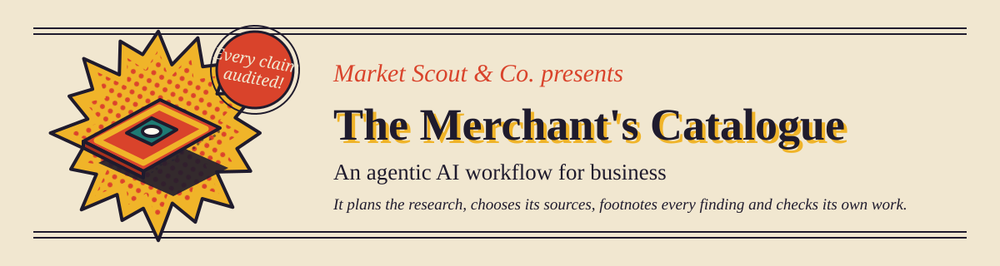
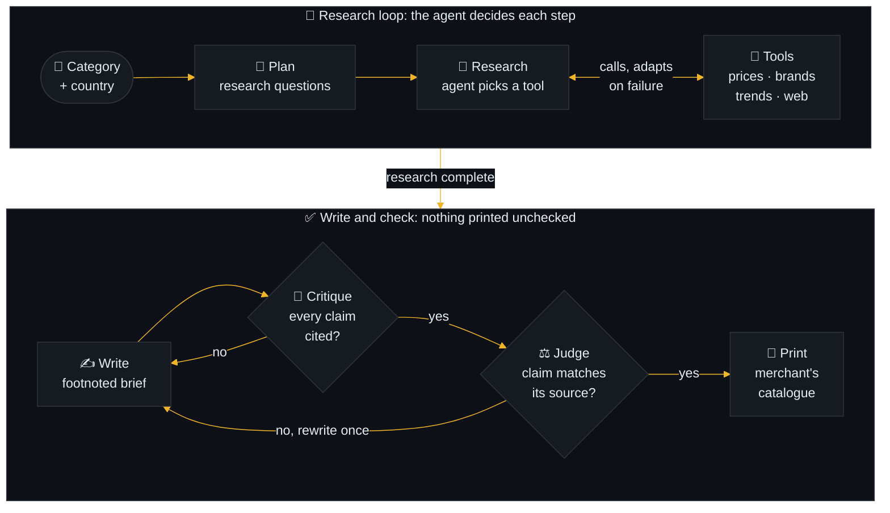

<div align="center">



<br>


[**The workflow**](#-the-agentic-workflow) · [**Origin**](#-where-this-came-from) · [**The catalogue**](#-the-catalogue) · [**Evals**](#-evals) · [**Quickstart**](#-quickstart) · [**Repo map**](#-repository-map) · [**Limits**](#-limits)

</div>

---

## 🎯 Overview

A category manager asks a simple question: *should we sell this product in this country,
and at what price?* Answering it normally takes an analyst days of gathering prices,
competitors and trends.

Market Scout is an **agentic AI workflow** that does that research on its own. Given a
product category and a country, the agent plans what to find out, chooses which data
sources to query, recovers when one fails, writes a brief in which every finding is
footnoted, has a second model audit each claim against its source, and prints the
result as a page from a vintage trade catalogue.



| | |
|---|---|
| **Problem** | Category and market research is slow, manual, and rarely shows where its numbers came from. |
| **Goal** | An agent that produces a seller's market brief in about a minute, with every claim traceable and checked. |
| **Who it's for** | Category managers, brand owners, e-commerce sellers, anyone deciding what to stock and how to price it. |
| **What makes it agentic** | It decides its own next step. Nothing in the research path is wired in advance. |
| **Origin** | Rebuilt from the n8n workflows I made during an externship with Wayfair. |

```bash
python -m marketscout "oat milk" --country FI
python -m marketscout.dashboard runs/oat-milk-fi-agent
```

## 🤖 The agentic workflow

"Agentic" is an overused word, so here is exactly what the agent decides for itself and
what is fixed.

| The agent decides | Fixed by design |
|---|---|
| Which questions the brief should answer | The stages: plan, research, write, critique, judge |
| Which tool to call next, and with what arguments | The rule that every claim must cite evidence |
| What to try when a source fails or comes back empty | How many retries and rewrites are allowed |
| When it has enough evidence to stop | The format of the brief |
| How to rewrite a claim the judge rejected | Who the reader is: the seller |

The agent is a [LangGraph](https://github.com/langchain-ai/langgraph) state machine.

| Step | What happens |
|---|---|
| 🧭 **Plan** | Turns "oat milk, FI" into three to five research questions |
| 🔎 **Research** | The model picks which tool to call next: structured data first, then web search |
| 🧰 **Tools** | Runs the call. A success becomes numbered evidence (E1, E2, ...). A failure is sent back so the agent can adapt |
| ✍️ **Write** | Drafts a brief: summary, findings, risks, recommendations, open questions |
| 🧐 **Critique** | Rejects the draft if any claim lacks a citation to evidence that exists |
| ⚖️ **Judge** | Reads each claim beside the evidence it cites and rules it supported, partly supported or unsupported. Unsupported claims send the draft back once |
| 📰 **Print** | Lays the brief out as a catalogue page, stamping any claim the judge did not fully back |

When more than one model provider has a key set, calls rotate between them as each hits
its rate limit, and the judge runs on a different provider from the writer, so the
writer does not mark its own homework.

### 🧰 Tools

| Tool | Source | Tells the seller |
|---|---|---|
| `wikipedia_interest` | Wikimedia pageviews, in the local language | Whether public interest is rising, and when it peaks |
| `eurostat_online_shopping` | Eurostat | How used the country is to buying online |
| `open_food_catalogue` | Open Food Facts | Which brands are already on sale (food and drink) |
| `web_search`, `fetch_page` | Tavily, then the page itself (robots.txt respected) | Market reports, news, competitor pages |
| `retail_price_comparison`, `social_trends`, `trend_articles` | Extern course data (optional) | Prices, best sellers and trends for rugs at US retailers |

All of them are free. Adding a tool is one decorated function in `tools.py`; the agent
discovers it from its description.

## 🧵 Where this came from

In August 2026 I completed an externship with **Wayfair** through Extern, building AI
workflows for category intelligence. The result was four **n8n** workflows that tracked
area-rug trends and competitors across Amazon, Walmart and Wayfair and produced a
content strategy and a dashboard.

Those workflows worked, but looking back at them honestly:

- They were **fixed prompt chains**. Each "agent" node was one LLM call in a set order,
  with no tools and no decisions about what to do next.
- They covered **one category** (rugs) for one retailer, on data served by the course.
- Nothing checked whether the output was **true**. The reports read well either way.
- A full run took around 15 minutes, most of it fixed waits between steps to stay
  under rate limits.

Market Scout is the same business idea rebuilt to fix those four things.

| | n8n workflows (v1) | Market Scout (v2) |
|---|---|---|
| Control flow | Fixed chain of prompts | Agent chooses its next tool at run time |
| Scope | Area rugs | Any category, 13 countries |
| Data | Course data server | Open sources, web search, optional course data |
| When a source fails | Run breaks or continues blind | Failure is reported back and the agent tries another angle |
| Evidence | None attached | Every claim cites a numbered source |
| Checking | None | Citation check, then a judge model reads each claim against its source |
| Measured | No | Eval scorecard comparing chain and agent |
| Typical run | About 15 minutes | Around one to two minutes |

The v1 design survives as `--mode chain`, a single prompt with no tools, so both can be
scored by the same harness. The optional rug tools exist to re-run the original Wayfair
scenario through the new agent; that data is a frozen snapshot from May 2026 and is not
redistributed here.

## 📰 The catalogue

`python -m marketscout.dashboard <run folder>` turns a saved run into one standalone
HTML page, addressed to the seller and styled as a mail-order trade catalogue:

- a drawn product on a starburst, animated at a deliberately choppy, hand-drawn rate
- "for the Finnish table", "for the American home": a line that follows the country
- key figures computed from the evidence data, not written by the model
- a competitor price list, and graphs printed in halftone ink
- risks as a caution notice, advice as a clip-out coupon
- the agent's lookups as numbered order slips, stamped received or returned empty
- claims the judge did not fully back are stamped where they appear
- one openly licensed photo from Wikimedia Commons, with its credit

Why a catalogue: the subject is retail, and a trade catalogue is the form in which
sellers have always been told what to stock and what it costs.

## 📊 Evals

```bash
python evals/run_evals.py
```

Runs each case in `evals/cases.json` through both modes and writes
[`evals/scorecard.md`](evals/scorecard.md).

| Metric | Meaning |
|---|---|
| claims | Bullets in findings, risks and recommendations |
| citation_coverage | Share of claims that cite evidence that exists |
| supported / partial / not_supported | The judge's rulings |
| faithfulness | Supported claims as a share of claims judged |
| tool_errors, revisions, tokens, seconds | What the run cost |

Results so far, on Groq's free `openai/gpt-oss-120b`:

| Run | Mode | Claims | Cited | Fully backed | Partly backed | Not backed |
|---|---|---|---|---|---|---|
| Oat milk, Finland | chain | 34 | 0 | not judged | | |
| Oat milk, Finland | agent | 8 | 8 | not judged | | |
| Olive oil, Spain | chain | 33 | 0 | not judged | | |
| Olive oil, Spain | agent | 3 | 3 | not judged | | |
| Area rug, Germany | chain | 40 | 0 | not judged | | |
| Area rug, Germany | agent | 4 | 4 | not judged | | |
| Area rug, United States | agent | 13 | 13 | 7 | 6 | 0 |

The first six rows are the last full scorecard, which predates the judge. The last row
is the first judged run: every claim was cited, but the judge ruled only 7 of 13 fully
backed. The other 6 were inferences the source did not state, such as a recommended
price tier drawn from a purchase-intent figure. That gap between "cited" and "backed" is
exactly what the citation check alone could not see. A full judged scorecard is the next
thing to run.

What these numbers do not show: the judge is itself a model and has not yet been
checked against human labels, and three cases is a demonstration, not a benchmark.

## ⚡ Quickstart

```bash
python -m venv .venv
.venv\Scripts\activate
pip install -e ".[dev]"
python -m marketscout "oat milk" --country FI --offline
pytest
```

`--offline` uses a scripted stand-in for the model (the data tools are still real), so
it works with no API key. For real runs, copy `.env.example` to `.env` and add a free
key from [Groq](https://console.groq.com), [Mistral](https://console.mistral.ai) or
[OpenRouter](https://openrouter.ai), plus [Tavily](https://tavily.com) for web search.
Each run saves `brief.md` and `run.json` under `runs/`.

## 📁 Repository map

```
src/marketscout/
  graph.py       the agent, and the chain baseline
  judge.py       the claim-against-evidence check
  tools.py       open data tools; add one with the @tool decorator
  extern.py      optional rug case-study tools
  llm.py         model client (Groq, Mistral, OpenRouter) and the offline stand-in
  dashboard.py   builds the catalogue page from a saved run
  cli.py         command line
evals/           cases, runner, scorecard
tests/           offline tests, no network or key needed
design/          the style prototypes that led to the catalogue
baseline/        where the original n8n workflow exports go
```

## 🚧 Limits

- Open product data is thin outside food and drink. Non-food categories lean on web
  search unless the optional rug data applies.
- Wikipedia pageviews measure curiosity, not sales, and the page says so.
- The judge catches claims that outrun their evidence. It does not check that the
  evidence itself is right.
- Free model tiers cap tokens per minute, so long sources are trimmed in prompts.
- The catalogue has four product drawings (carton, bottle, rug, box). Everything else
  gets the box.

## 🗺️ Roadmap

1. Hand-label a sample of claims to measure how often the judge agrees with a person.
2. Live mode: watch the catalogue print section by section as the agent works.
3. A licensed price source for European retailers, such as the eBay Browse API.
4. Cross-country mode: one category ranked across several countries.
5. A larger eval set and a written comparison of chain and agent.

## 🙏 Credits

Built on [LangGraph](https://github.com/langchain-ai/langgraph). Data from Wikimedia,
Eurostat and Open Food Facts under their open licences. Photos from Wikimedia Commons,
credited on each page. The original workflows were built during an externship with
Wayfair, run by Extern.
